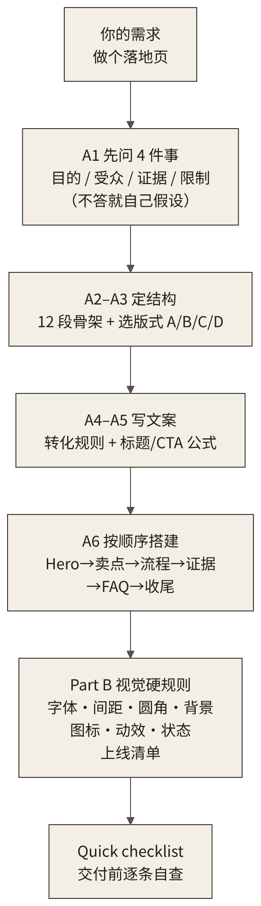
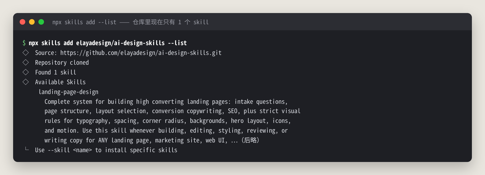
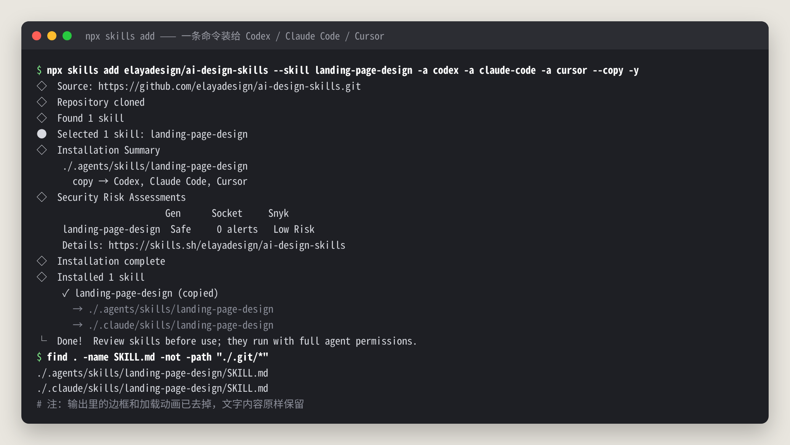
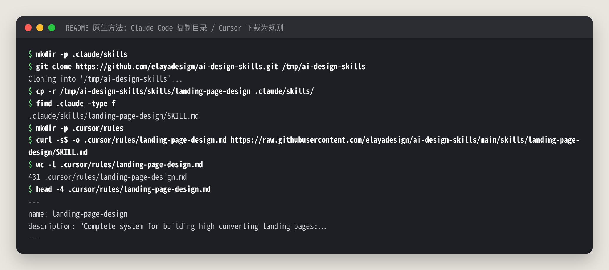
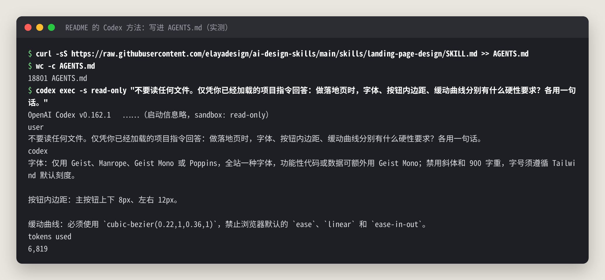

# ai-design-skills 中文教程：一份 SKILL.md 让 AI 做出“能上线”的落地页（Codex 实测改造前后对比）

> **非官方中文教程**。原项目 [elayadesign/ai-design-skills](https://github.com/elayadesign/ai-design-skills)（MIT，作者 Elaya），本仓库与原作者无关。

📚 免费版只讲“是什么、解决什么问题、各家 agent 怎么装”。完整版（SKILL.md 逐节拆解、Codex 改造前后实战、客观检查、和 impeccable 怎么配合、踩坑排错）在知识星球「开源抢先站」：[https://t.zsxq.com/mc4td](https://t.zsxq.com/mc4td)

🎟️ 首发 6 折：新人先领 20 元券，50 元变 30 元（限 50 张，11 月 29 日截止）👉 [领券](https://t.zsxq.com/jk0TT)

> 适用版本：elayadesign/ai-design-skills 主分支 `ded7efc9`（目前只有 `landing-page-design` 一个 skill）｜实测日期：2026-10-30｜实测环境：Codex CLI 0.162.1，npx skills 1.5.18  
> 文中所有终端输出、截图、agent 回复都来自真机实测，不是 README 的翻译。没实测的部分在文中标了「⚠️ 未实测」。

## 目录

- [0. 先说结论：值不值得装？](#0-先说结论值不值得装)
- [1. 它到底是什么？解决什么问题？](#1-它到底是什么解决什么问题)
- [2. 安装：按你用的 agent 来](#2-安装按你用的-agent-来)
- [3. 完整版还讲了什么](#3-完整版还讲了什么)
- [来源与许可](#来源与许可)

---

## 0. 先说结论：值不值得装？

让 agent 写落地页，最常见的结果不是“丑”，而是“差点意思”：

- 字号、间距随手写，`13px`、`gap: 10px`、`padding: 22px` 满页都是，放大看处处不齐
- 首屏一句很美的情绪文案，用户看完还是不知道你到底卖什么、在哪儿能用
- 按钮写“了解更多”“提交”，没有一个清楚的主行动
- 隐私政策、404、favicon、分享卡片、键盘焦点、表单报错……这些“上线前才想起来”的东西一概没有

**ai-design-skills 干的事，就是把一位落地页设计师的“做法 + 硬规矩”写成一份 431 行的 `SKILL.md`，让 agent 照着做。** 前半部分（Part A）管“页面说什么、怎么排”，后半部分（Part B）是一套不许商量的视觉规则：只许用哪几种字体、间距只许用哪几个值、圆角怎么嵌套、动效用哪条缓动曲线、上线前必须有哪些东西。

我用 Codex 给一个虚构的上海上门喂猫服务「喵上门」做了三次落地页：不装 skill 做一版、装了 skill 改造这一版、装了 skill 从零再做一版。实测结论：

- **它最值钱的不是“更好看”，而是“更完整、更守规矩”。** 现在的模型不装 skill 也能做出像样的页面（见完整版第 4.2 节）。装了以后，我自写的规则检查从 8/20 条通过变成 20/20；隐私说明、服务条款、favicon、分享标签、跳到正文链接、表单加载和行内报错这些全补齐了。
- **改造旧页面时，它让 agent 先“对照清单审一遍”再动手。** Codex 按 skill 的 Quick checklist 列出了 17 条不符合项，然后逐条修掉（完整版第 4.3 节），这一步比“帮我优化一下页面”靠谱得多。
- **它不是检测器，靠的是 agent 自觉。** 没有任何脚本会拦住 agent 违规，效果取决于模型读不读、守不守。要客观验收，可以配一个 impeccable 检测器：改造前 21 个反模式，改造后 3 个（完整版第 5、6 节）。
- **注意两边规则会打架**：ai-design-skills 强制首屏标题用文字渐变，而 impeccable 恰好把文字渐变当成“AI 味”。这种冲突要你自己拍板（完整版第 6 节）。
- **对中文页面要做一点适配**：它推荐的 Geist、Manrope 都没有中文字形，“逐词点亮”的标语对中文也要自己断词（完整版第 7 节）。
- 成本：一次从零生成大约 3.6 万 token（不含缓存命中），一次审查加改造约 5.2 万 token，和不装 skill 时差不多。



---

## 1. 它到底是什么？解决什么问题？

一句大白话：**ai-design-skills = 一份写给 agent 看的“落地页设计规范 + 作业流程”。**

它不是 npm 包，也没有任何可执行代码，整个仓库就是 Markdown 文件。作者把它定位成“一个不断增长的设计 skill 合集”，但截至本文实测（2026-10-30），`skills/` 目录下只剩 `landing-page-design` 一个。原来的 `design-to-motion` 已经在 2026-10-27 拆到单独的仓库；“改造已有网站”的配套 skill `redesign-existing-projects` 也在另一个仓库 [elayadesign/redesign-skill](https://github.com/elayadesign/redesign-skill)（本文没有实测它）。

| 问题 | 不装 skill 时 agent 的表现 | landing-page-design 的解法 |
|---|---|---|
| **不知道页面要干嘛** | 什么都想放，主次不分 | 开篇一句话：**一个产品 → 一类人 → 一个主行动**；A1 先问清目的、受众、证据、限制 |
| **结构靠感觉** | 首屏 + 三张卡片 + 页脚，套路化 | A2 给出 12 个区块的标准顺序，A3 给 A/B/C/D 四种布局让它选 |
| **文案空洞** | “赋能”“一站式”“了解更多” | A5 给文案公式，按钮必须是“动词 + 得到什么”，B8 列了一串禁用的空话 |
| **数值随手写** | 13px、gap 10px、圆角 14px | B1 只许用 Tailwind 字号刻度，B2 只许用 13 个间距值，B3 嵌套圆角有公式 |
| **动效廉价** | 默认 ease、`transition: all`、乱飘 | B7 指定缓动曲线和时长，只许动 transform 和 opacity，必须支持“减弱动态” |
| **上线缺东西** | 没有隐私页、404、favicon、og 标签 | B9 交互状态、B10 上线清单，最后再过一遍 Quick checklist |

几个需要先搞清楚的事实：

- **它对“用户的明确要求”让步。** Scope 一节原话：规则和框架默认值冲突时以 skill 为准；和用户的明确提示冲突时，**用户说了算**。所以你完全可以在提示词里说“不要用文字渐变”。
- **它适用范围写得很宽**：落地页、营销站、组件、仪表盘、原型、设计评审都算。description 里还写了“即使用户没提设计也要用”，所以装上之后 agent 做任何前端都可能触发它。
- **它会让 agent 先交 7 项规划再写代码**（Output format 一节），写完再过 Quick checklist（完整版第 3.3 节）。
- **致谢**：SKILL.md 里内容真实感、动效和导航的部分思路改编自 Leon Lin（[@LexnLin](https://x.com/LexnLin)）的 [taste-skill](https://github.com/Leonxlnx/taste-skill)（MIT），之后已经重写。

---

## 2. 安装：按你用的 agent 来

### 2.1 通用方式（推荐）：npx skills 一条命令

先看看仓库里有哪些 skill：

```bash
npx skills add elayadesign/ai-design-skills --list
```



然后装到项目里。下面这条一次装给 Codex、Claude Code、Cursor 三家，`--copy` 表示复制文件而不是建软链接，`-y` 跳过确认：

```bash
npx skills add elayadesign/ai-design-skills --skill landing-page-design \
  -a codex -a claude-code -a cursor --copy -y
```



装完要注意三点：

- **Codex 和 Cursor 共用 `./.agents/skills/`，Claude Code 单独放在 `./.claude/skills/`。** 所以三家只多出两份文件。
- 项目根目录会多一个 `skills-lock.json`，记录来源仓库、`SKILL.md` 路径和内容哈希，方便以后核对版本。
- 安装器顺带显示了三家安全扫描的结果（Gen：Safe，Socket：0 alerts，Snyk：Low Risk）。它最后提醒“skill 带着 agent 的全部权限运行，用前先看一遍”。这份 skill 只是纯文本规则，没有脚本，风险很低，但这个习惯值得保留。

在 Codex 里使用时，提示词开头写 `$landing-page-design` 就能点名调用。不点名的话，Codex 也会根据 description 自己判断要不要加载。

### 2.2 各家 agent 的差异（重点看你自己用的那家）

| 工具 | 官方 README 给的方法 | 我的实测情况 |
|---|---|---|
| **Codex CLI** | 把 `SKILL.md` 内容贴进 `AGENTS.md` | ✅ 实测：`npx skills` 装法和 `AGENTS.md` 装法都跑通（完整版第 4 节三次实战都用 npx 装法） |
| **Claude Code** | `git clone` 后 `cp -r` 到 `.claude/skills/` | ✅ 文件放置实测；⚠️ 未实测：没有真的启动 Claude Code 跑任务 |
| **Cursor** | `curl` 下载到 `.cursor/rules/<skill>.md`，或贴进 Settings → Rules for AI | ✅ 文件下载实测；⚠️ 未实测：没有在 Cursor 里跑任务 |
| **Windsurf** | 贴进 `.windsurfrules` | ⚠️ 未实测 |
| **Cline** | 贴进 `.clinerules` | ⚠️ 未实测 |
| **Claude.ai 网页版** | 上传到 Project，或附在对话里说“follow this” | ⚠️ 未实测 |
| **其他工具** | 贴进系统提示词 | ⚠️ 未实测 |

### 2.3 Claude Code 和 Cursor 的手动装法

照 README 原样执行的结果：



两点说明：

- Claude Code 这种装法和 `npx skills` 的结果一样，都是 `.claude/skills/landing-page-design/SKILL.md`。
- Cursor 这种装法下载下来的是带 YAML 头（`name` / `description`）的 `.md` 文件。Cursor 的项目规则现在一般用带自己 frontmatter 的 `.mdc` 格式，这个 `.md` 能不能被正确识别为规则、什么时候生效，我没有在 Cursor 里验证。⚠️ 未实测。稳妥的做法是用 2.1 节的 npx 装法，或者直接把内容贴进 Rules for AI。

### 2.4 Codex 的 AGENTS.md 装法（README 原方法）

README 给 Codex 的方法是把 `SKILL.md` 整份贴进 `AGENTS.md`。我实测时让 Codex 在只读沙箱里、**不许读任何文件**，只凭它已经加载的项目指令回答三条硬规则：



三条答案都和 SKILL.md 原文一致，说明 `AGENTS.md` 确实被自动加载了。

**但我更推荐 skill 装法**：`AGENTS.md` 会在每一轮对话都整份塞进上下文。这份规则有 18,801 字节，大约 5 千 token，你修个后端 bug 也要背着它。skill 装法平时只占一行 description，用到时才读全文。

---

## 3. 完整版还讲了什么

下面这些章节在知识星球的完整版里：

| 章节 | 一句话简介 |
|---|---|
| SKILL.md 逐节拆解 | Part A 八节（问清需求、12 个区块、四种布局、转化规则、文案公式、构建顺序、SEO、常见坑）和 Part B 十一节视觉硬规则，每条翻成中文并说明怎么用；7 项规划和 Quick checklist |
| 完整实战：喵上门 | 同一段提示词，不装 skill、装了改造、装了从零做三次 Codex 实测，首屏、整页、手机端、标语逐词点亮的对比截图，Codex 列出的 17 条不符合项和改造回执，token 账单 |
| 客观检查 | 按 SKILL.md 硬规则逐条查（8/20 → 20/20），再用 impeccable 检测器扫（21 → 3），以及剩下几条为什么去不掉 |
| 和 impeccable 怎么选 | 两者定位对比表、规则冲突表（文字渐变、浅暖色背景、Geist 字体），一起用时的流程 |
| 常见坑和解法 | 14 个实测踩到或看到的坑：Geist、Manrope 没有中文字形，中文逐词点亮怎么切词，Codex 自作主张加 noindex，示例内容“编得像真的”上线前要换掉等 |
| 进阶玩法 | fork 一份改成自己的设计规范（附中文页面补丁片段），只审查不改代码的提示词，配套的 redesign skill |
| 没实测的部分 | 哪些内容来自官方文档、为什么没测，一张表说清楚 |

---

## 加入知识星球「开源抢先站」看完整版

完整 SKILL.md 拆解、Codex 改造前后实战、客观检查、踩坑排错：[https://t.zsxq.com/mc4td](https://t.zsxq.com/mc4td)


🎟️ 首发 6 折新人券（20 元，限 50 张，2026-11-29 截止）：[https://t.zsxq.com/jk0TT](https://t.zsxq.com/jk0TT)，先领券再加入更划算。

---

## 来源与许可

- 原项目：<https://github.com/elayadesign/ai-design-skills>（实测版本 `ded7efc9`）
- 原项目采用 **MIT 许可**，Copyright (c) 2026 Elaya。本仓库是独立撰写的非官方使用教程，不是官方文档，与原作者没有隶属或背书关系；文中引用的规则名、数值和少量英文原文属于原项目，版权归原作者所有。
- 据原 SKILL.md 的 Credits：landing-page-design 的部分内容（改造审查结构、内容真实感检查、动效和导航思路）改编自 Leon Lin（[@LexnLin](https://x.com/LexnLin)）的 [taste-skill](https://github.com/Leonxlnx/taste-skill)，MIT 许可，Copyright (c) 2026 Leonxlnx，之后已重写。
- 文中“喵上门”是为演示虚构的服务。
- 本教程的文字与图片采用 [CC BY-NC-SA 4.0](LICENSE.md) 许可。
